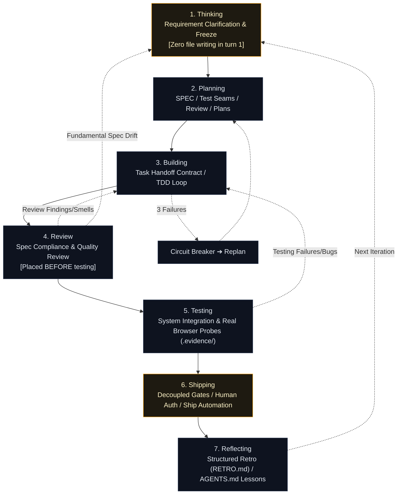

<p align="center">
  
</p>

<p align="center">
  <strong>A lifecycle orchestrator for reliable AI-assisted software engineering.</strong><br>
  <em>From vibe coding to engineered delivery.</em>
</p>

<p align="center">
  <a href="LICENSE"></a>
  <a href="docs/CONSTITUTION.md"></a>
  <a href="tests/results/v0.2.md"></a>
  <a href="#multi-agent-compatibility"></a>
</p>

<p align="center">
  <a href="#-quick-start">Quick Start</a> •
  <a href="#-the-paradigm-shift">Why Vibe Workflow</a> •
  <a href="#-multi-agent-compatibility">Compatibility</a> •
  <a href="docs/CONSTITUTION.md">Constitution</a> •
  <a href="README.zh-CN.md">简体中文</a>
</p>

---

## 💡 What is Vibe Workflow?

AI coding agents can generate hundreds of lines of code in seconds. However, when deployed on **multi-step, multi-session software projects**, they inevitably derail:

- **Scope Creep**: A casual prompt causes the agent to silently alter database schemas or delete core constraints.
- **Context Drift**: In a new session, the agent hallucinates past decisions and starts overwriting working code.
- **Retry Doom-Loops**: The agent patches the same failing test 5 times, breaking adjacent modules and compounding technical debt.
- **False Completion**: The agent confidently claims `DONE! Everything is tested`, without running a single build command.

**Vibe Workflow is an engineering lifecycle orchestrator.**  
It does not teach an LLM how to write a function; it provides the **state machine, gates, and repository discipline** that ensure an agent delivers verifiable, production-grade software over days and weeks.

> 🎯 **Core Division of Responsibility**:  
> **Matt 的 `grilling`** 负责自动需求对质，`grill-me` 供用户显式调用。<br/>
> **Vibe Workflow** reliably orchestrates *how* it gets built and verified.

---

## 🎭 The Paradigm Shift

| Failure Mode | Without Vibe Workflow | With Vibe Workflow |
| :--- | :--- | :--- |
| **Vague Rush Requests** | Agent guesses missing specs, generates throwaway code. | **Entry Gate Trips**: Halts execution until requirements are `FROZEN`. |
| **Mid-flight Scope Changes** | Agent silently hacks in features, breaking existing architecture. | **Requirement Change Gate**: Halts work, isolates impact, requires human approval. |
| **Repeated Failures** | Agent blind-patches until codebase collapses. | **Circuit Breaker**: Halts at 3 failures, snapshots state, and forces replanning. |
| **Completion Claims** | "All done!" (Code looks plausible, build is broken). | **Evidence Gate**: Strict rejection of "Done" without fresh passing test logs. |
| **Memory Across Sessions** | Relies on fading chat history; hallucinates past state. | **Repository as Memory**: Rehydrates exclusively from Git and living docs. |

---

## ⚡ Five Core Engineering Pillars

1. **Requirements Freeze & Entry Gates**: Engineering never begins on ambiguous intent. Four observable conditions are required: `Requirement Status == FROZEN`, `Open Questions == None`, `Release ID exists`, and `Acceptance Goals are testable`.
2. **Repository is Memory, Chat is Conversation**：Git、测试与仓库现有事实文档承载持久状态；`docs/vibe/` 只是新项目的建议结构。
3. **Decoupled Verification & Shipping Gates**：发布必须先达到 `READY_TO_SHIP`，再获得精确授权；风险接受不能把缺失证据改成 `VERIFIED`。
4. **Circuit Breaker (Zero Retry Loops)**: When an agent encounters 3 consecutive failures, cascades regressions, or disproves core assumptions, it must:
   ```text
   STOP PATCHING
     → Preserve last known good state
     → Capture Debug Snapshot in PROGRESS.md
     → Set Operational Status = REPLAN_REQUIRED
     → Replan in a clean context window
   ```
5. **Context Governor (Attention Shield)**: Prevents context window poisoning by injecting only the *Minimal Sufficient Context* (Task Context Pack) and excluding historical releases and massive git logs.

---

## 🔄 The 7-Stage Agile Lifecycle



*For complete transition contracts, state definitions, and rollback rules, see [Lifecycle Specification](skills/vibe-workflow/references/lifecycle.md).*

---

## 🧩 Ecosystem Role Matrix (V0.3 Explicit Invocations & Fallbacks)

Vibe Workflow is a lifecycle orchestrator coordinating the 7-stage agile pipeline:

| Stage | Preferred External Skill | Core Responsibility | Graceful Fallback (When Skill Absent) |
|---|---|---|---|
| **1. Thinking** | **Matt 的 `grilling`**（自动）／**`grill-me`**（用户显式调用） | 澄清需求边界与验收条件，首轮不创建工程文档 | 降级为内置结构化提问协议，不自动调用仅限用户使用的入口 |
| **2. Planning** | **`superpowers:brainstorming`** ➔ **`gstack:autoplan`** ➔ **`superpowers:writing-plans`** | Multi-approach exploration ➔ multi-role review ➔ executable plan with Test Seams & Ready Frontier | Built-in architectural review and dependency matrix |
| **3. Building** | **`superpowers:test-driven-development`**<br/>**`gstack:investigate`** (on CB) | Task dispatch with mandatory TDD red-green cycle; circuit breaking after 3 consecutive failures | Built-in failing test first & minimal implementation protocol |
| **4. Review** | **`gstack:review`**<br/>**`gstack:deslop-shared-libs`**<br/>**`gstack:cso`** | **Placed before testing**: Spec compliance, concurrency, leaks, codebase deslop, STRIDE threat modeling | Built-in rigorous diff review and scope boundary check |
| **5. Testing** | **`gstack:qa`** / **`gstack:browse`**<br/>**`superpowers:verification-before-completion`** | Real browser interaction, console error logging (zero errors), and screenshot archive in `.evidence/` | Native Playwright, Chromium CLI, or built-in test runners |
| **6. Shipping** | **`gstack:ship`** | Automated version bump, changelog audit, git tag/commit/PR upon explicit human approval | Standard git commit and release commands |
| **7. Reflecting** | **`gstack:retro`** | Automated commit & friction analysis, lessons learned written back into `AGENTS.md` | Built-in `RETRO.md` template for manual reflection |

> 💡 **Explicit Invocation Principles**:  
> - **需求澄清**：自动对质优先使用 Matt 的 `grilling`；用户显式请求 `grill-me` 时使用该入口；首轮不创建工程文档，技能不可用时降级为内置结构化提问协议；
> - **Verification**: Drive real browser probes for UI projects; store unforgeable logs and screenshots into `.evidence/`;  
> - **Review**: Independent review stage placed before system testing to catch spec drift early;  
> - **Reflecting**: Continuous improvement loop via `RETRO.md` and `AGENTS.md` rules.

---

## 🚀 Quick Start

### 1. Installation

Install via the cross-agent CLI standard:

```bash
# Recommended for Claude Code, Cursor, and modern agents
npx skills add sz-xiaohuolong/vibe-workflow
```

Or clone and run the unified repository installer:

```bash
git clone https://github.com/sz-xiaohuolong/vibe-workflow.git
cd vibe-workflow
./install.sh
```

### 2. Common Workflows

#### 存量仓库接管（v0.2）
```text
$vibe-workflow init 审计当前仓库，沿用已有文档与构建入口，建立或刷新唯一的职责地图，并报告待澄清事实。
```

`init` 可重复执行；已有地图优先沿用，缺少时才创建 `DOCUMENT_MAP.md`。v0.2 还明确六类跨模块触发，并区分 `IMPLEMENTED_UNVERIFIED`、`POC_VALIDATED`、`VERIFIED`。行为回归记录见 [v0.2 验证](tests/results/v0.2.md)。

v0.2.1 的文档约定：`PROGRESS`/`SPEC` 首屏先给最多三行摘要；短切片只在当前 Release 的计划与进度中推进；原始运行证据默认放在被忽略的 `.evidence/`，正式 Release 验证需另有可长期取回的证明。参见[中文说明](README.zh-CN.md)与[行为复核](tests/results/v0.2.1.md)。

#### Start a New Project
```text
$vibe-workflow Check the Entry Gate and initialize Release v0.1 from our frozen requirements.
```

#### Resume Across Sessions
```text
$vibe-workflow Resume current project from repository facts and verify the next pending task.
```

#### Handle a Mid-Flight Scope Change
```text
$vibe-workflow Assess the impact of adding user avatars, draft a Change Proposal, and halt affected building.
```

---

## 🔌 Multi-Agent Compatibility

Vibe Workflow follows the open `SKILL.md` specification ([agentskills.io](https://agentskills.io/)).

| Agent / Environment | Support Tier | Installation Path / Method | Verification Status |
| :--- | :--- | :--- | :--- |
| **OpenAI Codex** | **Native Skill** | `./install.sh codex` or in-chat `$skill-installer` | ✅ **Verified** |
| **Claude Code** | **Native Skill** | `npx skills add sz-xiaohuolong/vibe-workflow` or `./install.sh claude` | ✅ **Verified** |
| **Antigravity / Gemini CLI** | **Native Skill** | `~/.gemini/config/skills/` or `./install.sh gemini` | ✅ **Verified** |
| **Cursor** | **Rule Adapter** | `./install.sh cursor` (`.cursor/rules/vibe-workflow.mdc`) | 📝 Documented |
| **Windsurf** | **Rule Adapter** | `.windsurfrules` (via `adapters/windsurf/`) | 📝 Documented |
| **Cline / Roo Code** | **Rule Adapter** | `.clinerules` (via `adapters/cline/`) | 📝 Documented |
| **OpenCode** | **Native Skill** | Standard `SKILL.md` directory mounting | 📝 Documented |

*See [Installation Guides](docs/installation/) for platform-specific setup.*

---

## ⚖️ When to Use vs. When NOT to Use

### ✅ Use Vibe Workflow When:
- Projects span multiple sessions, PRs, or releases.
- Requirements must remain strictly bounded against agent creep.
- You need high-stakes gates before database migrations, security changes, or deployments.
- You want auditable, evidence-backed proof before declaring completion.

### ❌ You Do NOT Need It When:
- You are tweaking a single line of CSS or copy (**Tiny tasks bypass documentation**).
- You are writing a one-off throwaway prototype script.
- You are running open-ended exploratory chat queries.

---

## 🛡️ Trust & Verification

Vibe Workflow was built and validated using **Skill TDD**:
- **25 Adversarial Scenarios**: Subjected to pressure testing (rushed demos, cascading failures, unauthorized schema edits, and fake completion claims).
- **Dual-Blind Microtests**: Rigorously benchmarked with Control (no skill) vs. Candidate evaluations.
- **验证记录**：v0.1 的 25 个场景见 [`tests/results/v0.1.md`](tests/results/v0.1.md)；v0.2 的七项规则走查与独立执行证据见 [`tests/results/v0.2.md`](tests/results/v0.2.md)。

Run static compliance checks locally:
```bash
./tests/validate_skill.sh
```

---

## 📚 Deep Dive Documentation

- [The Engineering Constitution](docs/CONSTITUTION.md) — The 10 inviolable rules.
- [Lifecycle & State Machine](docs/concepts/lifecycle.md) — State transitions, entry conditions, and rewinds.
- [Human Decision Gates & Schema Protocol](docs/concepts/decision-gates.md) — The 5-step migration rules and risk tags.
- [Circuit Breaker & Recovery](docs/concepts/circuit-breaker.md) — Tripping criteria and Debug Snapshots.
- [Context Governor](docs/concepts/context-governor.md) — The three context packs and exclusion policies.
- [Artifact Model & Traceability](docs/concepts/artifacts.md) — Living documents vs. archived releases.

---

## 🤝 Contributing & License

Contributions are welcome! Please review [CONTRIBUTING.md](CONTRIBUTING.md) before submitting behavioral modifications.  
Distributed under the [MIT License](LICENSE).
