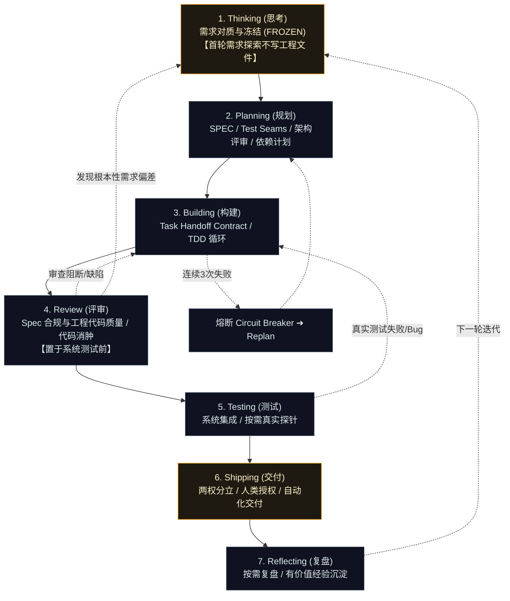

<p align="center">
  
</p>

<p align="center">
  <strong>专为长期软件工程项目打造的 Agent 生命周期与决策编排器 (Lifecycle Orchestrator)</strong><br>
  <em>让 Vibe Coding 从“一锤子买卖的玩具 Demo”，真正走向“跨会话、可验证、高可靠的生产级工程交付”。</em>
</p>

<p align="center">
  <a href="LICENSE"></a>
  <a href="docs/CONSTITUTION.md"></a>
  <a href="tests/results/v0.2.md"></a>
  <a href="#-多-agent-兼容性矩阵"></a>
</p>

<p align="center">
  <a href="#-快速开始-quick-start">快速开始</a> •
  <a href="#-核心范式转变">为什么需要它</a> •
  <a href="#-多-agent-兼容性矩阵">兼容性矩阵</a> •
  <a href="docs/CONSTITUTION.md">工程宪法</a> •
  <a href="README.md">English</a>
</p>

---

## 💡 什么是 Vibe Workflow？

现在的 AI Coding Agent 可以在几秒内写出成百上千行代码。但是，一旦把 Agent 放入**跨任务、跨会话、跨 Release 的真实复杂软件工程**中，项目往往迅速失控：

- **需求漂移 (Scope Creep)**：一句随口的口头催促，Agent 擅自修改了数据库字段甚至移除了核心校验；
- **会话失忆 (Context Drift)**：新开一个会话，Agent 靠聊天记忆产生幻觉，推翻之前已验证的架构；
- **盲目修 Bug 死循环 (Doom-Loops)**：同一个报错换着参数连改 5 次，修 A 坏 B，改到代码库彻底报废；
- **虚假完成声明 (False "Done")**：在没有任何测试或构建命令输出的情况下，轻率宣布 `DONE! All features implemented`。

**`vibe-workflow` 是一套软件工程生命周期编排 Skill。**  
它不教大模型怎么写某个具体函数，而是提供**状态机、人类决策关卡 (Gates) 和仓库工程纪律**，确保 Agent 在数天甚至数周的长期演进中，交付可验证、生产级的软件。

> 🎯 **核心权责分工**：  
> **Matt 的 `grilling`** 负责自动需求对质，`grill-me` 供用户显式调用；<br/>
> **Vibe Workflow** 负责可靠地把它做出来并验证 (How to execute and verify)。

---

## 🎭 核心范式转变 (Before vs. After)

| 典型翻车场景 | 没有 Vibe Workflow 的 Agent | 装备 Vibe Workflow 的 Agent |
| :--- | :--- | :--- |
| **模糊加急需求** | 擅自猜测缺失边界，产出一堆玩具代码。 | **触发入口 Gate 拦截**：四项可观察条件未全部满足前，严禁写代码。 |
| **中途随口加功能** | 顺手修改代码，破坏既有架构并引入依赖冲突。 | **触发 Requirement Change Gate**：暂停受影响工作，提交变更影响提案待人类批准。 |
| **同类 Bug 连续失败** | 盲目重试 Patch，直至代码结构崩塌。 | **触发 Circuit Breaker 熔断**：连续 3 次失败立即停手，保存现场并强制重新规划。 |
| **完成交付汇报** | “全部搞定！”（实际上 build 都跑不通）。 | **触发 Evidence Gate 门禁**：没有对应当前输入与环境的有效证据，不声称完成。 |
| **跨会话记忆恢复** | 依赖模糊的聊天记录；产生架构幻觉。 | **Repository is Memory**：只从 Git、测试和已验证的 living docs 恢复状态。 |

---

## ⚡ 五大核心工程支柱

1. **需求冻结与入口门禁**：完整 Release 开始前须满足需求 `FROZEN`、无阻塞问题、Release ID 和可测验收目标。Tiny/Bounded 使用已确认的任务范围，已有授权不重复申请。
2. **Repository is Memory, Chat is Conversation**：聊天上下文是瞬态的。Git、测试和仓库现有事实文档承载持久状态；`docs/vibe/` 只是新项目的建议结构。
3. **证据 (Verification) 与发布 (Shipping) 两权分立**：Release 先凭证据达到 `READY_TO_SHIP`，再取得精确发布授权；风险接受不能把缺失证据改写为 `VERIFIED`。
4. **熔断机制 (Circuit Breaker，拒绝无脑重试)**：当出现连续 3 次同类失败、修 A 坏 B 或基础假设失效时：
   ```text
   STOP PATCHING
     → 保留/恢复 Last Known Good State 稳定状态
     → 在 PROGRESS.md 中记录 Debug Snapshot
     → 置 Operational Status = REPLAN_REQUIRED
     → 在干净的上下文窗口中重新规划
   ```
5. **上下文节流器 (Context Governor)**：按需注入*最小充分上下文* (Task Context Pack)，默认彻底排除历史全量 Release 文档和冗长 Git Log，防止上下文污染与 Token 浪费。

---

## 🔄 七阶段敏捷开发模型 (Standard 7-Stage Agile Lifecycle)



*完整状态机转移规范、字段定义与回退矩阵，请参阅 [生命周期深度规范](skills/vibe-workflow/references/lifecycle.md)。*

---

## 🧩 专业生态协同矩阵 (V0.3 显式调用与优雅降级)

Vibe Workflow 根据任务范围选择能力；以下是可选能力，不是每次必须完整执行的技能链。调用名称以宿主实际注册项为准，例如 `gstack:review` 可能显示为 `gstack-review`。

| 阶段 | 按需选择的技能 | 调用边界与降级 |
|---|---|---|
| **1. Thinking** | Matt `grilling`；用户显式请求时用 `grill-me` | 只澄清未决产品问题；首轮需求探索不创建工程文档。缺失时内置结构化提问。 |
| **2. Planning** | `gstack:autoplan` 或单项评审；`superpowers:writing-plans` | 冻结需求不重新访谈；brainstorming 7 不作固定前置。复用既有计划，复杂多维方案才用 autoplan。 |
| **3. Building** | `superpowers:test-driven-development`；必要时选一种执行或排障技能 | 行为改动用 TDD/回归验证，文案不造测试；简单任务直接执行。SDD 的实现任务串行，不与另一编排器竞争。 |
| **4. Review** | `gstack:review` 或 `superpowers:requesting-code-review` | 一个主审查；实际安全或重复代码问题才追加 cso/deslop。Tiny 自查，Bounded 聚焦受影响部分。 |
| **5. Testing** | `gstack:qa-only`、`gstack:browse` 或原生测试 | 纯验收不自动修复提交；qa 的副作用须在授权范围内。有效证据可复用，缺少真实环境须记录缺口。 |
| **6. Shipping** | 默认原生 Git + 项目发布命令；显式要求 PR 才按需 ship | 个人开发直接提交/推送，不强制 PR 或功能分支；同步远程不隐含发版，发布须核验目标与版本结果。 |
| **7. Reflecting** | `gstack:retro` 或简短总结 | 有复杂过程或用户需求才跑 retro；有价值经验才更新 AGENTS，不为仪式新建文档。 |

调用前明确目标、范围、输出路径、副作用、验证预算和停止点；不能遵守边界时使用更窄能力或内置协议。完整规则见[编排契约](skills/vibe-workflow/references/orchestration.md)。

**轻量任务**：精确、单点、低风险的修改直接读取相关文件、修改、最小检查、汇报；不要求 Release ID、整套文档、子代理、worktree 或 `.evidence/`。多文件或多会话本身不意味着必须走架构流程；权限、迁移等实际风险仍先检查。

**验证与存储**：相同被测输入和相关环境下的真实证据可复用，通过后停止；变化使证据失效时重验受影响部分。Web 行为验收需要真实运行，截图按视觉需要采集，HAR/视频/trace 默认关闭。项目可在 `AGENTS.md` 覆盖证据预算，见[使用指南](docs/USER_GUIDE.zh-CN.md#44-按项目配置证据策略)。


---

## 🚀 快速开始 (Quick Start)

### 1. 一键安装

推荐使用跨 Agent 的开放标准工具链：

```bash
# 适用于 Claude Code、Cursor 等现代 Agent
npx skills add sz-xiaohuolong/vibe-workflow
```

或者克隆仓库并运行通用安装脚本：

```bash
git clone https://github.com/sz-xiaohuolong/vibe-workflow.git
cd vibe-workflow
./install.sh
```

### 2. 常用工作流示例

#### 接管已有项目（v0.2）
```text
$vibe-workflow init 审计当前仓库，沿用已有文档和构建入口，建立或刷新唯一的职责地图，并报告待澄清事实。
```

重复执行 `init` 会复核地图的真实路径和证据，只更新变化项。仓库已有 `PROJECT.md` 地图时继续沿用；缺少地图时才创建 `DOCUMENT_MAP.md`。需求尚未冻结时也可审计现状，但进入 SPEC、设计或开发仍需通过工程入口 Gate。

正常 init 还会自动合并[通用 Agent 工作约定](skills/vibe-workflow/assets/templates/AGENT_RULES.md)：沿用项目已采用的 `AGENT.md` 或 `AGENTS.md`，无入口时按用户指定名称或默认 `AGENTS.md` 建立。只补语义缺口，保留人工内容与冲突规则，重复执行不制造 diff；明确只读时只报告建议。文件名兼容不保证宿主自动加载，恢复时按真实入口读取。详见[使用教程](docs/USER_GUIDE.zh-CN.md#32-接管已有仓库)。

v0.2 还明确六类跨模块触发条件，并在进度中区分 `IMPLEMENTED_UNVERIFIED`（已实现待验证）、`POC_VALIDATED`（已通过 POC）和 `VERIFIED`（已验证）；前两者不能作为正式功能完成证据。

从 v0.2.1 起，项目文档默认先展示最多三行的人类摘要：当前事实、阻塞和下一步。Release 才建立版本目录；同一 Release 的短切片只在计划与进度中推进，不生成整套文档。默认保留摘要；确有需要的运行日志、原始指标才放在项目根目录 `.evidence/`（默认忽略），`docs/` 保留可读结论与证据指针；正式 Release 的已验证声明还须有可长期取回的证明，必要时归档至 CI/artifact。已有项目沿用其等价路径，不自动迁移旧证据。详细约定见 [Artifact 规则](skills/vibe-workflow/references/artifacts.md)。

内容按读者目的组织借鉴了 [Diátaxis 官方指南](https://diataxis.fr/how-to-use-diataxis/)；它并不要求预建四类目录。摘要卡和 `.evidence/` 是本 Skill 为上述问题制定的约定，并非 Diátaxis 的硬性规则。

存量接管与文档地图的设计参考了 [project-vibe-spec](https://github.com/dnwwdwd/project-vibe-spec)，并按本 Skill 的 Release 状态机与证据规则进行了独立整合。

#### 启动新项目 / 新 Release

空仓库可直接调用 `$vibe-workflow`：首轮需求澄清不写工程文件；范围与验收确认且获准进入 Planning 后，自动完成最小规则接入，无需额外 init。已有明确授权直接沿用；Tiny、普通 Git 与临时目录单点任务不触发初始化。

```text
$vibe-workflow 检查工程入口 Gate，并基于当前冻结的需求初始化 v0.1 Release 流程。
```

#### 跨会话恢复工作
```text
$vibe-workflow 从仓库事实恢复当前软件项目，并核验下一个待执行的 Task。
```

#### 处理开发中的需求变更
```text
$vibe-workflow 评估新增用户头像功能对当前架构的影响，生成变更提案，并暂停受影响模块。
```

---

## 🔌 多 Agent 兼容性矩阵

Vibe Workflow 严格遵循 open `SKILL.md` 规范 ([agentskills.io](https://agentskills.io/))。

| Agent / 环境 | 支持级别 | 安装方式 / 路径 | 验证状态 |
| :--- | :--- | :--- | :--- |
| **OpenAI Codex** | **原生 Skill** | `./install.sh codex` 或 对话中 `$skill-installer` | ✅ **已验证 (Verified)** |
| **Claude Code** | **原生 Skill** | `npx skills add sz-xiaohuolong/vibe-workflow` 或 `./install.sh claude` | ✅ **已验证 (Verified)** |
| **Antigravity / Gemini** | **原生 Skill** | `~/.gemini/config/skills/` 或 `./install.sh gemini` | ✅ **已验证 (Verified)** |
| **Cursor** | **规则适配** | `./install.sh cursor` (`.cursor/rules/vibe-workflow.mdc`) | 📝 文档支持 |
| **Windsurf** | **规则适配** | `.windsurfrules` (通过 `adapters/windsurf/`) | 📝 文档支持 |
| **Cline / Roo Code** | **规则适配** | `.clinerules` (通过 `adapters/cline/`) | 📝 文档支持 |
| **OpenCode** | **原生 Skill** | 标准 `SKILL.md` 目录挂载 | 📝 文档支持 |

*详细的手动配置说明，见 [安装配置指南](docs/installation/)。*

---

## ⚖️ 什么时候用，什么时候不用？

### ✅ 适用场景：
- 项目跨越多个会话、多个 PR 或多个 Release。
- 必须严格控制需求边界，防止 AI 擅自扩范围。
- 涉及数据库表结构变更、安全权限改动或生产发布的关键关卡。
- 需要基于真实测试证据的可追踪交付。

### ❌ 不适用场景（避免流程官僚化）：
- 修改一行 CSS 样式或文案（**Tiny 任务直接使用 task-local intent，零多余文档**）。
- 编写一次性丢弃型脚本或 Demo 原型。
- 探索性的开放问答。

---

## 🛡️ 可信度与 Skill TDD 验证

`vibe-workflow` 自身完全基于工业级 **Skill TDD** 严苛流程构建：
- **25 个真实对抗场景**：承受高压催促演示、权限暗度陈仓、Schema 偷跑、虚假完成声明等工程危机测试。
- **双盲微测评估**：Control（无技能对照组）与 Candidate 严格对比。
- **证据落盘**：v0.1 的 25 个对抗场景见 [`tests/results/v0.1.md`](tests/results/v0.1.md)；v0.2 新增七项规则走查和独立执行记录见 [`tests/results/v0.2.md`](tests/results/v0.2.md)。

运行本地静态与结构校验：
```bash
./tests/validate_skill.sh
```

---

## 📚 深度技术文档

- [用户使用教程](docs/USER_GUIDE.zh-CN.md) — 从安装、接管到 Release 验证的完整使用路径，以及项目文档职责说明。
- [工程宪法 (The Engineering Constitution)](docs/CONSTITUTION.md) — 十大不可违背的法典与判例。
- [生命周期与状态机 (Lifecycle Specification)](docs/concepts/lifecycle.md) — 状态迁移、准入条件与回退协议。
- [决策门禁与 Schema 协议 (Decision Gates)](docs/concepts/decision-gates.md) — 数据库五步闭环与风险标签。
- [熔断机制与恢复 (Circuit Breaker)](docs/concepts/circuit-breaker.md) — 熔断条件与 Debug Snapshot 规范。
- [上下文节流器 (Context Governor)](docs/concepts/context-governor.md) — 三级上下文 Pack 与过滤白名单。
- [产物模型与事实所有权 (Artifact Model)](docs/concepts/artifacts.md) — 活文档 vs 封存产物的所有权矩阵。

---

## 🤝 贡献与开源协议

欢迎社区共同完善！提交行为规则修改前请阅读 [CONTRIBUTING.md](CONTRIBUTING.md)。  
本项目基于 [MIT License](LICENSE) 开源。
