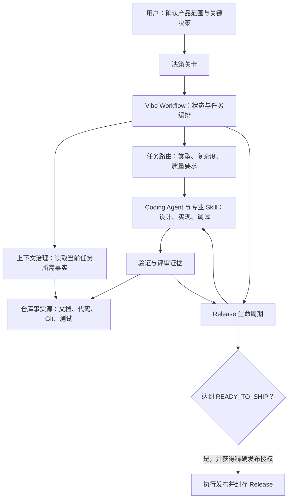
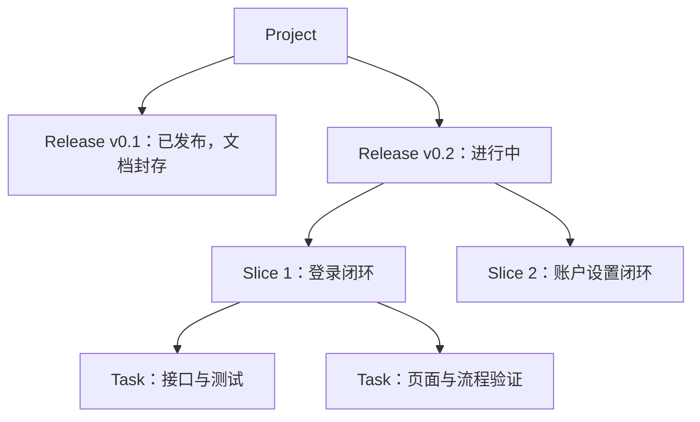
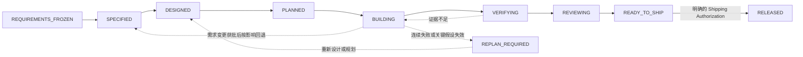
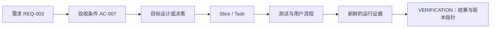

# Vibe Workflow 使用教程

本文面向使用 AI Coding Agent 维护软件项目的开发者和项目负责人。读完后，你可以判断何时启用 Vibe Workflow、如何启动或恢复一个 Release，以及每份项目文档该记录什么。

## 1. Vibe Workflow 是什么

Vibe Workflow 是一套面向长期软件工程的 Agent 工作流 Skill。它管理需求冻结、任务路由、生命周期状态、人工决策关卡、上下文恢复和完成证据；具体编码、测试和调试则交给 Coding Agent 及相应的专业 Skill。

它尤其适合跨会话、跨功能或跨 Release 的项目，以及涉及数据库、权限、公开接口或正式发布的工作。对于一个范围明确、风险很低的单点修改，可以走轻量的 Tiny Task 路径，不必创建整套 Release 文档。

它的核心分工是：**人决定产品承诺和关键风险；Agent 在已确认的边界内决定实现细节，并用证据说明结果。** 聊天用来协作，仓库中的代码、测试和明确归属的文档用来保存可恢复的项目事实。

## 2. 架构设计与核心设计

### 2.1 工作流的组成



工作流有四个关键机制：

1. **工程入口 Gate**：开始新项目或新 Release 的规格、设计和开发前，必须有已冻结的需求、零未决问题、Release ID 和可检验的验收目标。`init` 的现状审计可以先进行。
2. **Release 状态机**：每次推进都要有对应产物或证据，不能仅凭“这个阶段做完了”改状态。
3. **事实所有权**：当前产品预期、当前实现、目标设计、执行位置和历史发布分别由不同事实源负责；冲突要显式核对。
4. **验证与发布分离**：测试证据决定是否已验证，人工授权决定是否可以执行外部发布动作。授权不会把缺失的证据变成“已验证”。

### 2.2 Release、Slice 与 Task

**Project** 是长期维护的产品或代码库；**Release** 是一次有独立范围、验收与发布边界的周期；**Slice** 是该 Release 内可运行、可验证的纵向切片；**Task** 是切片内更小的执行单元。



Slice 不自动生成新的 Release，也不需要各自复制一套 SPEC、计划和验证文档。已发布版本的后续修复应进入新的 patch Release 或后续 Release，不能直接改写旧版本的历史快照。

### 2.3 状态与关卡



`Operational Status` 与上述 `Workflow State` 分开记录，可为 `ACTIVE`、`WAITING_HUMAN`、`BLOCKED` 或 `REPLAN_REQUIRED`。例如开发中等待数据库方案批准时，Release 仍可处于 `BUILDING`，但操作状态应是 `WAITING_HUMAN`。

产品范围、公开兼容性、数据库结构、权限与安全、重要外部服务、不可逆操作，以及推送、PR、部署和发布等动作，都有相应的人工决策关卡。内部命名、私有辅助函数和局部测试组织通常由 Agent 自主决定。具体关卡以 [Skill 规则](../skills/vibe-workflow/SKILL.md) 为准。

### 2.4 从需求到证据的追踪链



Release 验证要逐项回答“每条需求和验收条件是否有证据支持”。代码已写、概念验证通过和正式功能已验证是不同状态，应分别记录为 `IMPLEMENTED_UNVERIFIED`、`POC_VALIDATED` 和 `VERIFIED`。

### 2.5 四份核心文档如何接力

| 阶段 | 文档 | 回答的问题 |
|---|---|---|
| 需求概要与冻结 | `PROJECT_BRIEF.md` | 本次 Release 为谁解决什么问题，范围、约束和可观察目标是什么？ |
| 需求详细规格 | `SPEC.md` | 已冻结的意图具体表现为哪些用户行为、流程、错误、边界和验收条件？ |
| 目标技术方案 | `PROPOSED_DESIGN.md` | 为实现这些 REQ/AC，准备如何改变架构、接口、数据与验证方式？方案是否获批？ |
| 当前技术事实 | `TECH_DESIGN.md` | 代码、配置和运行证据证明项目现在实际采用什么架构？ |

这四份文档不是从粗到细反复改写同一份设计。`PROJECT_BRIEF.md` 是产品意图基线；`SPEC.md` 只能展开已冻结的产品意图，不能自行增加范围；`PROPOSED_DESIGN.md` 是本次 Release 的**目标技术设计**，不能充当需求决定；`TECH_DESIGN.md` 是随已实现且经核验的架构变化持续更新的 living document。接管已有项目时，可以先根据现有代码与配置建立 `TECH_DESIGN.md` 的当前事实；新方案实现并验证后，再把成立的部分并入其中。

## 3. 如何使用

### 3.1 安装并调用

在本仓库运行安装脚本，并按使用的 Agent 选择目标；例如 Codex：

```bash
./install.sh codex
```

其他环境的安装方法见 [安装文档目录](installation/)。安装后在 Agent 对话中使用 `$vibe-workflow` 调用 Skill。`init` 是对话中的子命令，**不是需要另装的命令行程序**。

### 3.2 接管已有仓库

先让 Agent 审计现状并建立或刷新唯一的文档地图：

```text
$vibe-workflow init 审计当前仓库，沿用已有需求、设计、测试和进度文档，建立或刷新事实源地图，并列出待澄清事项。
```

`init` 会检查适用的 `AGENTS.md`、仓库状态、构建和测试入口，以及已有事实文档。已有地图时更新它；没有地图时才创建 `DOCUMENT_MAP.md`。未确认的需求标为“待澄清”，不能从现有代码猜出历史产品批准，也不能因为完成审计就开始开发。重复运行 `init` 只复核并更新变化项。

### 3.3 启动新项目或新 Release

先提供或确认以下四项：

| 入口条件 | 需要明确什么 |
|---|---|
| `Requirement Status == FROZEN` | 本次产品范围已有明确的人类决定 |
| `Open Questions == None` | 没有影响产品行为或验收的未决问题 |
| 当前 Release ID 存在 | 本次交付属于哪个版本 |
| Acceptance Goals 可测试 | 如何判断用户目标已达成 |

然后可以这样提出任务：

```text
$vibe-workflow 检查工程入口 Gate。基于已确认的需求启动 v0.2 Release，建立本次有效 SPEC、实施计划和进度记录，再按计划推进。
```

缺少任何入口条件时，Agent 应先列出缺口并协助澄清需求。对于精确、低风险、无额外产品选择的 Tiny Task，可以把当前请求当作该任务的局部冻结意图，做最小实现和验证。

### 3.4 开发、恢复与变更

开发时，Agent 先检查适用 Gate，再判断任务类型、复杂度、所需文档和验证强度，最后决定执行顺序。每个 Task 只加载相关的需求、设计、代码和测试，完成后记录新鲜证据并更新进度。

跨会话继续工作时，可以直接说：

```text
$vibe-workflow 从仓库事实恢复当前 Release、状态和下一个 Task，并核验 PROGRESS 中的记录。
```

恢复顺序通常是 `AGENTS.md` → 唯一文档地图 → `PROGRESS` → 当前 Release 的相关 SPEC → 当前 Task 所需设计、代码、测试和证据。聊天记录只提供线索，不能覆盖 Git、代码和测试事实。

中途改变产品行为时，提出变更并等待影响分析与必要决定：

```text
$vibe-workflow 评估增加用户头像对当前 v0.2 范围、接口和验收的影响，先形成变更提案。
```

变更获批后，按最早失效的阶段回退：产品行为变更回到 SPEC，模块或数据模型变更回到设计，任务顺序变化回到计划。同类失败连续三次、修复引发多处回归或关键架构假设失效时，应停止局部补丁，保存调试快照并重新规划。

### 3.5 验证与发布

Task 完成时检查相关测试、构建或类型检查、受影响的用户流程和 diff，并把命令、时间、环境、结果及证据位置记入进度。Release 级验证还需逐项覆盖 REQ/AC、回归、风险检查、文档一致性和评审发现。

只有证据覆盖适用范围、阻断问题已解决，Release 才能进入 `READY_TO_SHIP`。随后，发布、部署等动作还需要针对目标、环境和动作的明确授权。成功后记录实际版本、产物或部署结果，并封存该 Release 的历史文档。

## 4. 文档规范

### 4.1 一个职责，一个权威事实源

优先沿用项目已有文档及路径，避免再建平行的 `docs/vibe/`。以下目录仅是新项目的建议结构：

```text
AGENTS.md
DOCUMENT_MAP.md                 # 仅在没有既有地图时创建
docs/vibe/
├── PROJECT.md
├── TECH_DESIGN.md
├── PROGRESS.md
├── decisions/DEC-xxx.md        # 按需创建
├── bugs/BUG-xxx.md             # 按需创建
└── releases/<release-id>/
    ├── PROJECT_BRIEF.md
    ├── CHANGE.md               # 有跨版本差异时使用
    ├── SPEC.md
    ├── PROPOSED_DESIGN.md      # 有目标架构方案时使用
    ├── IMPLEMENTATION_PLAN.md
    └── VERIFICATION.md         # 验证阶段填写
```

`PROJECT.md` 可以承载现有文档地图；此时不要再创建 `DOCUMENT_MAP.md`。Release 的核心事实职责需要保留，但文件内容应按实际范围保持精简；可选文件不为凑齐目录而新建。Tiny Task 通常只需精确请求、diff 和证据；受治理项目再按现有约定同步一条进度记录。

### 4.2 写作与证据规则

- `PROGRESS.md` 和 `SPEC.md` 标题下先放最多三条数据行的摘要：当前事实或范围、阻塞或边界、下一步或验收入口。正文再给明细，避免重复维护同一状态。
- 未知事实写“待澄清”或“未验证”；未通过入口 Gate 时不能把模板中的需求状态写成 `FROZEN`。
- `SPEC.md` 写当前 Release 的完整有效行为；`CHANGE.md` 只写相对上一 Release 的差异。不要让 Agent 叠加多版差异来推导当前需求。
- `PROPOSED_DESIGN.md` 写尚待实现的目标设计和批准状态；`TECH_DESIGN.md` 只写经过代码、配置或运行证据核验的当前架构。
- 原始测试日志、运行 dump 和指标 JSON 默认放在项目根目录 `.evidence/<release-id>/<slice-or-task-id>/`，并忽略本地目录；Markdown 文档写可读结论、命令、时间、结果和证据指针。支撑正式 Release 声明的证据还需有可长期取回的 CI、归档产物或版本化快照。
- Release 进入 `RELEASED` 后，原版需求、规格、方案、计划和验证记录作为历史快照保留。后续变化进入新 Release；必要纠错用有日期和依据的勘误记录。

### 4.3 每份文档的作用

| 文档 | 何时使用 | 记录的核心事实 |
|---|---|---|
| `AGENTS.md` | Agent 开始或恢复任务时 | 长期行为规则、事实源入口、项目命令；不复制产品正文 |
| `PROJECT.md` | 项目定位或当前版本变化时 | 项目边界、当前 Release、质量档位；可包含文档地图 |
| `DOCUMENT_MAP.md` 或既有地图 | 接管与定位资料时 | 各职责的真实路径、状态和依据；只导航，不复制业务内容 |
| `TECH_DESIGN.md` | 接管时记录已核验的现状；此后架构变化经实现和验证后持续更新 | 当前真实模块、接口、数据、权限、运行方式和验证入口 |
| `PROGRESS.md` | 每次执行、阻塞或状态变化后 | 当前 State/Status、Slice/Task、稳定点、证据、下一步 |
| `PROJECT_BRIEF.md` | 每个新 Release 的需求概要与冻结阶段 | 问题、目标用户、范围、限制、验收目标和未决问题，作为需求基线 |
| `CHANGE.md` | 需要说明相对上一 Release 的变化时 | 新增、修改、删除、修复及兼容或迁移提示 |
| `SPEC.md` | 入口 Gate 通过后详细展开已冻结需求 | 当前 Release 的完整有效产品行为、REQ/AC、错误与边界 |
| `PROPOSED_DESIGN.md` | 本次 Release 有目标技术方案时 | 待实现的目标架构、接口或数据影响、恢复与验证设计、批准状态 |
| `IMPLEMENTATION_PLAN.md` | 实施前及计划调整时 | Slice、Task、依赖、涉及文件、验证方式和 REQ/AC 对应关系 |
| `VERIFICATION.md` | Release 验证与评审阶段 | 每个 REQ/AC 的实际结果、证据、版本指针和未验证项 |
| `DEC-xxx.md` | 重大、长期影响的选择需追溯时 | 备选方案、取舍、人类决定、影响和恢复方式 |
| `BUG-xxx.md` | 排查与修复 Bug 时 | 症状、复现、证据、根因、修复和回归检查 |

模板位于 [`skills/vibe-workflow/assets/templates/`](../skills/vibe-workflow/assets/templates/)。复制适用模板后删除空章节和占位符；现有仓库已有等价文档时继续使用原文档。

## 5. 一个完整的使用示例

假设你要给已有应用增加“用户导出个人数据”功能：

1. 运行 `$vibe-workflow init`，定位当前 SPEC、架构、测试和进度来源。
2. 明确导出范围、格式、权限、失败行为和验收方式；冻结本次 Release 需求。
3. 在 `SPEC.md` 中记录 REQ/AC；若涉及权限或外部存储，先完成相应决策关卡。
4. 在目标设计和计划中把导出接口、后台任务、页面入口及测试映射到 Slice/Task。
5. 按 Task 实现并收集证据，更新 `PROGRESS.md`；出现未批准的范围变化时暂停受影响工作。
6. 在 `VERIFICATION.md` 逐项核对 REQ/AC、权限检查、失败路径和可取回的证据。评审通过后进入 `READY_TO_SHIP`，取得明确发布授权再发布。

更细的规则可查阅 [生命周期](concepts/lifecycle.md)、[决策关卡](concepts/decision-gates.md)和 [Artifact 规则](../skills/vibe-workflow/references/artifacts.md)。
