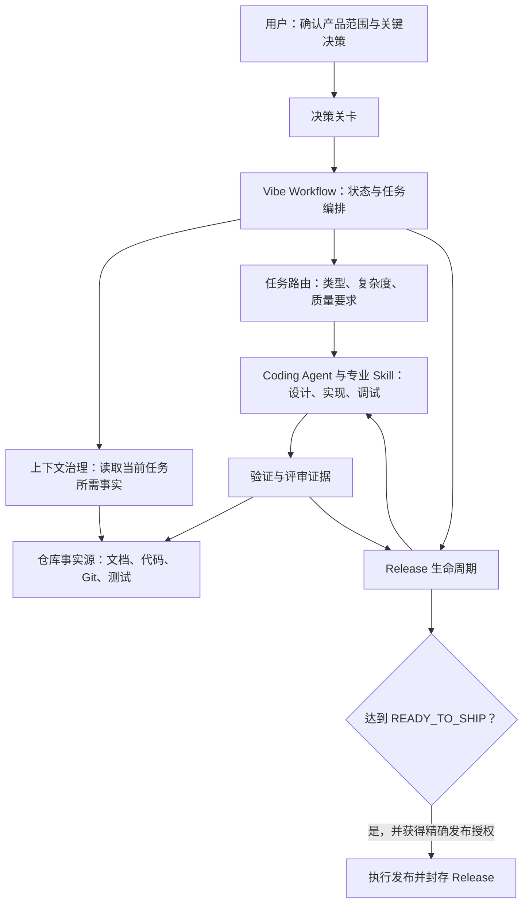
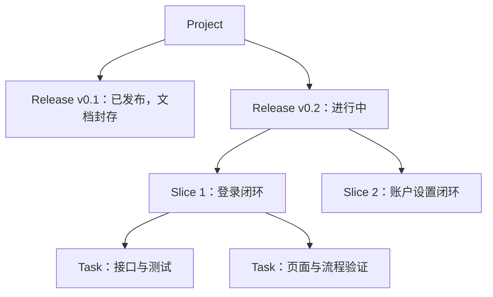
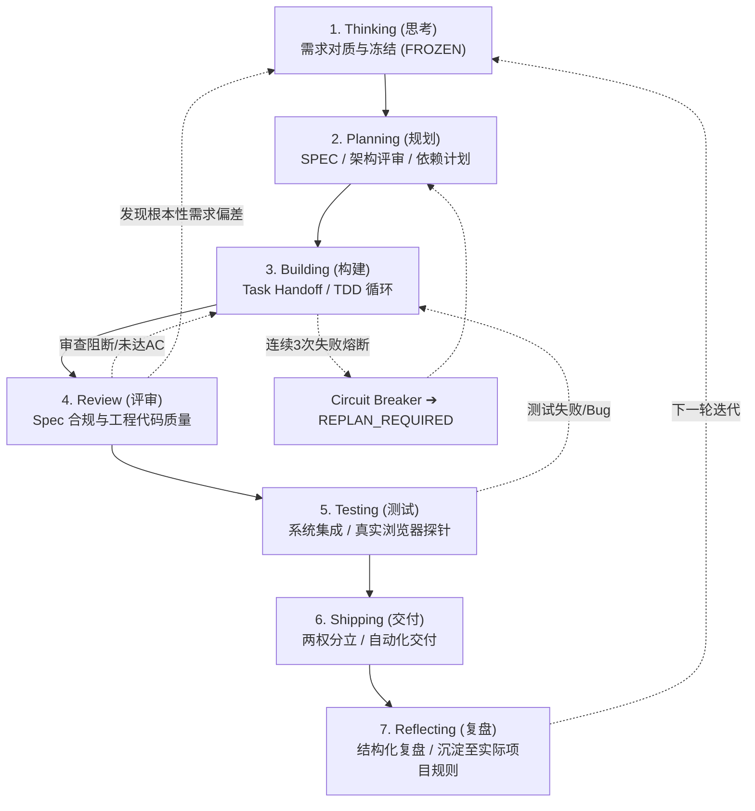

# Vibe Workflow 使用教程

本文面向使用 AI Coding Agent 维护软件项目的开发者和项目负责人。读完后，你可以判断何时启用 Vibe Workflow、如何启动或恢复一个 Release，以及每份项目文档该记录什么。

## 1. Vibe Workflow 是什么

Vibe Workflow 是一套面向长期软件工程的 Agent 工作流 Skill。它管理需求冻结、任务路由、生命周期状态、人工决策关卡、上下文恢复和完成证据；具体编码、测试和调试则交给 Coding Agent 及相应的专业 Skill。

它尤其适合跨会话、跨功能或跨 Release 的项目，以及涉及数据库、权限、公开接口或正式发布的工作。对于一个范围明确、风险很低的单点修改，可以走轻量的 Tiny Task 路径，不必创建整套 Release 文档。

它的核心分工是：**人决定产品承诺和关键风险；Agent 在已确认的边界内决定实现细节，并用证据说明结果。** 聊天用来协作，仓库中的代码、测试和明确归属的文档用来保存可恢复的项目事实。

## 2. 架构设计与核心设计

### 2.1 工作流的组成



工作流有四个关键机制：

1. **工程入口 Gate**：开始新项目或新 Release 的规格、设计和开发前，必须有已冻结的需求、零未决问题、Release ID 和可检验的验收目标。`init` 的现状审计可以先进行。
2. **Release 状态机**：每次推进都要有对应产物或证据，不能仅凭“这个阶段做完了”改状态。
3. **事实所有权**：当前产品预期、当前实现、目标设计、执行位置和历史发布分别由不同事实源负责；冲突要显式核对。
4. **验证与发布分离**：测试证据决定是否已验证，人工授权决定是否可以执行外部发布动作。授权不会把缺失的证据变成“已验证”。

### 2.2 Release、Slice 与 Task

**Project** 是长期维护的产品或代码库；**Release** 是一次有独立范围、验收与发布边界的周期；**Slice** 是该 Release 内可运行、可验证的纵向切片；**Task** 是切片内更小的执行单元。



Slice 不自动生成新的 Release，也不需要各自复制一套 SPEC、计划和验证文档。已发布版本的后续修改先作为任务或下一版候选记录；形成实际发布边界时才创建 patch/后续 Release，不能改写旧版本历史快照。

### 2.3 七阶段敏捷生命周期与状态流转

七阶段是完整 Release 的状态模型；Tiny/Bounded 按本次风险走轻量路径，不逐阶段重跑所有技能。完整 Release 遵循 **七阶段敏捷开发流程**，并在系统级测试（Testing）之前独立设置发布评审（Review），支持根据证据随时回退：



`Operational Status` 与宏观阶段分开记录，可为 `ACTIVE`、`WAITING_HUMAN`、`BLOCKED` 或 `REPLAN_REQUIRED`。例如开发中等待数据库方案批准时，Release 仍可处于 `BUILDING`，但操作状态应是 `WAITING_HUMAN`。

产品范围、公开兼容性、数据库结构、权限与安全、重要外部服务、不可逆操作，需要相应的明确决定；已有授权可沿用。普通 Commit/Push/PR 走轻量 Git，不进入 Shipping；正式部署和发布须核对验证状态及精确目标授权。内部命名、私有辅助函数和局部测试组织通常由 Agent 自主决定。具体关卡以 [Skill 规则](../skills/vibe-workflow/SKILL.md) 为准。

### 2.4 从需求到证据的完整追踪链


Release 验证要逐项回答“每条需求和验收条件是否有证据支持”。代码已写、概念验证通过和正式功能已验证是不同状态，应分别记录为 `IMPLEMENTED_UNVERIFIED`、`POC_VALIDATED` 和 `VERIFIED`。

### 2.5 核心文档如何接力闭环

| 阶段 | 文档 | 回答的问题 |
|---|---|---|
| 1. Thinking | `PROJECT_BRIEF.md` | 本次 Release 为谁解决什么问题，范围、约束和可观察目标是什么？ |
| 2. Planning | 需求分析 `SPEC.md` | 做什么、边界是什么、怎样验收？复杂流程、状态及测试接缝按实际需要展开。 |
| 2. Planning | 方案设计 `PROPOSED_DESIGN.md` | 选择什么方案、为什么，影响和风险是什么？方案是否获批？ |
| 2. Planning | 实施计划 `IMPLEMENTATION_PLAN.md` | 先做什么、依赖什么、怎样验证和恢复？复杂委派时再组装完整交接契约。 |
| 3. Building | `TECH_DESIGN.md` (Living) | 代码、配置和运行证据证明项目现在实际采用什么架构？（经实现核验后持续更新） |
| 5. Testing | `VERIFICATION.md` | 每个 REQ/AC 与 Test Seams 的实际测试结果、真实环境日志与截屏证据索引是什么？ |
| 7. Reflecting | `RETRO.md` | 本次 Release 的返工瓶颈、漏测原因、规则沉淀与下一版本候选池是什么？ |

这几份文档不是从粗到细反复改写同一份设计。`PROJECT_BRIEF.md` 是产品意图基线；`SPEC.md` 只能展开已冻结的产品意图，不能自行增加范围；`PROPOSED_DESIGN.md` 是本次 Release 的**目标技术设计**，不能充当需求决定；`TECH_DESIGN.md` 是随已实现且经核验的架构变化持续更新的 living document。接管已有项目时，可以先根据现有代码与配置建立 `TECH_DESIGN.md` 的当前事实；新方案实现并验证后，再把成立的部分并入其中。

## 3. 如何使用

### 3.1 安装并调用

在本仓库运行安装脚本，并按使用的 Agent 选择目标；例如 Codex：

```bash
./install.sh codex
```

其他环境的安装方法见 [安装文档目录](installation/)。安装后在 Agent 对话中使用 `$vibe-workflow` 调用 Skill。`init` 是对话中的子命令，**不是需要另装的命令行程序**。

### 3.2 接管已有仓库

先让 Agent 审计现状并建立或刷新唯一的文档地图：

```text
$vibe-workflow init 审计当前仓库，沿用已有需求、设计、测试和进度文档，建立或刷新事实源地图，并列出待澄清事项。
```

`init` 先检查适用项目规则、仓库状态、构建和测试入口及已有事实文档，再把[通用工作约定](../skills/vibe-workflow/assets/templates/AGENT_RULES.md)合并到项目规则文件。正常 init 已授权必要的规则接入与文档入口更新，不再询问是否添加；若明确要求“只读审计”或“不修改文件”，则只报告建议和差异。

优先沿用项目已明确采用的 `AGENT.md` 或 `AGENTS.md`，不重命名、不生成两份重复规则；没有现有入口时，使用用户指定名称，否则默认 `AGENTS.md`。已有语义等价规则不重复添加，只补缺失内容；人工内容、项目约束、语言、命令和目录规则保留。实质冲突保留现状并说明具体未合并项；维护区域标记不授权覆盖人工修改。两个入口职责无法确定时先报告分歧。文件名兼容不保证宿主自动加载，需遵循宿主机制，必要时显式读取真实入口。

已有地图时更新它；没有地图时才创建 `DOCUMENT_MAP.md`，并登记真实规则路径。未确认的需求标为“待澄清”，不能从代码猜出历史产品批准，也不能因为完成审计就开始开发。相同输入再次 init 不产生重复段落、时间戳或无意义 diff。模板更新不会批量改写旧项目，下次 init 才核对可确认差异。

### 3.3 启动新项目或新 Release

空仓库直接调用 `$vibe-workflow` 即可启动新项目。需求尚未冻结时，自动需求对质优先使用 Matt 的 `grilling`；用户显式请求 `grill-me` 时使用该用户入口。首轮需求澄清不创建规则文件、工程文档、脚手架或业务代码；技能不可用时，Agent 会说明情况并降级为内置结构化提问协议，不自动调用仅限用户使用的入口。

先提供或确认以下四项：

| 入口条件 | 需要明确什么 |
|---|---|
| `Requirement Status == FROZEN` | 本次产品范围已有明确的人类决定 |
| `Open Questions == None` | 没有影响产品行为或验收的未决问题 |
| 当前 Release ID 存在 | 本次交付属于哪个版本 |
| Acceptance Goals 可测试 | 如何判断用户目标已达成 |

范围与可测验收确认、获准进入 Planning 后，Agent 自动按同一入口与合并协议建立最小规则文件，在正式实现前写入通用约定，无需额外执行 init。用户已提供明确范围和必要授权时直接复用，不增加一轮确认。规则只加入已核验的文档入口；未来方案、命令和目录不能写成既有事实，也不为此预建完整文档套件。

可以这样提出任务：

```text
$vibe-workflow 检查工程入口 Gate。基于已确认的需求启动 v0.2 Release，建立本次有效 SPEC、实施计划和进度记录，再按计划推进。
```

完整 Release 缺少入口条件时，Agent 应先列出缺口并协助澄清需求。精确、低风险的 Tiny Task 使用当前请求作为局部冻结意图，做最小实现和验证；Tiny、普通 Git、临时目录单点任务和只读审计不触发新项目规则初始化。

### 3.4 开发、恢复与变更

开发时，Agent 先检查适用 Gate，再判断任务类型、复杂度、所需文档和验证强度，最后决定执行顺序。每个 Task 只加载相关的需求、设计、代码和测试，完成后记录新鲜证据并更新进度。

跨会话继续工作时，可以直接说：

```text
$vibe-workflow 从仓库事实恢复当前 Release、状态和下一个 Task，并核验 PROGRESS 中的记录。
```

恢复时按宿主机制和既有入口声明定位实际规则文件（`AGENT.md` 或 `AGENTS.md`），再沿唯一文档地图 → `PROGRESS` → 当前 Release 相关 SPEC → 当前 Task 所需设计、代码、测试和证据读取。写入与恢复采用同一[入口定位协议](../skills/vibe-workflow/references/init.md#规则入口定位)，不能只查默认文件名。聊天记录只提供线索，不能覆盖 Git、代码和测试事实。

中途改变产品行为时，提出变更并等待影响分析与必要决定：

```text
$vibe-workflow 评估增加用户头像对当前 v0.2 范围、接口和验收的影响，先形成变更提案。
```

变更获批后，按最早失效的阶段回退：产品行为变更回到 SPEC，模块或数据模型变更回到设计，任务顺序变化回到计划。同类失败连续三次、修复引发多处回归或关键架构假设失效时，应停止局部补丁，保存调试快照并重新规划。

### 3.5 评审、测试、发布与复盘

- **Stage 4：Review**：Tiny 自查、Bounded 聚焦受影响部分；复杂 Release 在高成本系统测试前选一个主审查。确有重复实现问题才使用 deslop，不为审查制造重构。
- **Stage 5：Testing**：按受影响行为运行必要测试，复用仍适用的真实结果。只读验收优先 qa-only/browse/原生工具；截图和日志按验收与诊断需要采集。完整 Release 的适用 REQ/AC 全部有证据后才到 `READY_TO_SHIP`。
- **Stage 6：Shipping**：个人开发默认沿用明确分支直接提交/推送，用项目命令发布；已有授权不重复申请，不默认开 PR、功能分支、worktree 或运行 ship。只有显式要求 PR 才创建，分支保护拒绝直推时报告限制并等待选择。核验实际目标、版本及适用结果后记录发布完成。
- **Stage 7：Reflecting**：简单交付在既有记录简短总结；复杂过程或用户要求时才用 retro，有价值的重复经验才更新实际项目规则入口。

个人项目可以直接这样区分操作：

| 请求 | 实际流程 |
|---|---|
| “把这次改动同步到远程” | 核对 diff、分支与已有证据 → 提交并推送；不自动发版或开 PR |
| “把已验证的版本发布为 vX.Y.Z” | 核对范围、版本和目标授权 → 项目约定的版本/变更说明 → 提交、推送及必要 Tag/Release/发布命令 → 核验结果；不加 PR 环节 |
| “为这次修改开一个 PR” | 核对 head/base、范围与授权 → 推送所需分支并创建 PR；不自动合并或发布 |

小版本发布的范围、验证和授权可以集中在既有发布记录中，不要求为 Shipping 补齐整套文档。

## 4. 文档规范

### 4.1 一个职责，一个权威事实源

优先沿用项目已有文档及路径，避免再建平行的 `docs/vibe/`。以下目录仅是新项目的建议结构：

```text
AGENTS.md
DOCUMENT_MAP.md                 # 仅在没有既有地图时创建
docs/vibe/
├── PROJECT.md
├── TECH_DESIGN.md
├── PROGRESS.md
├── decisions/DEC-xxx.md        # 按需创建
├── bugs/BUG-xxx.md             # 按需创建
└── releases/<release-id>/
    ├── PROJECT_BRIEF.md
    ├── CHANGE.md               # 有跨版本差异时使用
    ├── SPEC.md
    ├── PROPOSED_DESIGN.md      # 有目标架构方案时使用
    ├── IMPLEMENTATION_PLAN.md
    ├── VERIFICATION.md         # 验证阶段填写
    └── RETRO.md                # 复盘阶段填写
```

上例的 `AGENTS.md` 是无既有入口且用户未指定时的默认名称；已采用 `AGENT.md` 时沿用它。`PROJECT.md` 可以承载现有文档地图；此时不要再创建 `DOCUMENT_MAP.md`。Release 的核心事实职责需要保留，但文件内容应按实际范围保持精简；可选文件不为凑齐目录而新建。Tiny Task 通常只需精确请求、diff 和证据；受治理项目再按现有约定同步一条进度记录。

### 4.2 写作与证据规则

- `PROGRESS.md` 和 `SPEC.md` 标题下先放最多三条数据行的摘要：当前事实或范围、阻塞或边界、下一步或验收入口。正文再给明细，避免重复维护同一状态。
- 未知事实写“待澄清”或“未验证”；未通过入口 Gate 时不能把模板中的需求状态写成 `FROZEN`。
- `SPEC.md` 写当前 Release 的完整有效行为；`CHANGE.md` 只写相对上一 Release 的差异。不要让 Agent 叠加多版差异来推导当前需求。
- `PROPOSED_DESIGN.md` 写尚待实现的目标设计和批准状态；`TECH_DESIGN.md` 只写经过代码、配置或运行证据核验的当前架构。
- 默认保留可读结论、命令、时间、输入/环境依据和结果指针；需要保留的原始日志才暂存 `.evidence/<release-id>/<slice-or-task-id>/`，并忽略本地目录。Tiny 不要求目录。相同输入和环境的有效结果可复用；支撑正式 Release 声明的证明须长期可取回。
- Release 进入 `RELEASED` 且复盘封存后，原版需求、规格、方案、计划、验证和复盘记录作为历史快照保留。后续变化进入新 Release；必要纠错用有日期和依据的勘误记录。

### 4.3 每份文档的作用

新建或实质修改需求分析、方案设计、实施计划和进度时，Agent 自动按需应用[文档写作规范](../skills/vibe-workflow/references/document-quality.md)：先给结论，明确必要信息和章节裁剪条件，写完自行检查。小更新保持局部，旧文档随任务渐进整理，不新增逐篇审批；写法参考[正例与反例](../skills/vibe-workflow/assets/examples/document-quality.md)。

| 文档 | 何时使用 | 记录的核心事实 |
|---|---|---|
| 实际规则入口（`AGENT.md` 或 `AGENTS.md`） | Agent 开始或恢复任务时 | 长期行为规则、事实源入口、已核验项目命令、跨会话反模式沉淀；不复制产品正文 |
| `PROJECT.md` | 项目定位或当前版本变化时 | 项目边界、当前 Release、质量档位；可包含文档地图 |
| `DOCUMENT_MAP.md` 或既有地图 | 接管与定位资料时 | 各职责的真实路径、状态和依据；只导航，不复制业务内容 |
| `TECH_DESIGN.md` | 接管时记录已核验的现状；此后架构变化经实现和验证后持续更新 | 当前真实模块、接口、数据、权限、运行方式和验证入口 |
| `PROGRESS.md` | 每次执行、阻塞或状态变化后 | 当前 Stage/State/Status、Slice/Task、稳定点、证据、下一步 |
| `PROJECT_BRIEF.md` | 每个新 Release 的需求概要与冻结阶段 | 问题、目标用户、范围、限制、验收目标和未决问题，作为需求基线 |
| `CHANGE.md` | 需要说明相对上一 Release 的变化时 | 新增、修改、删除、修复及兼容或迁移提示 |
| 需求分析 `SPEC.md` | 入口 Gate 通过后展开已冻结需求 | 完整有效行为、REQ/AC、错误与边界；流程、状态和接缝细节按条件补充 |
| 方案设计 `PROPOSED_DESIGN.md` | 有目标技术方案时 | 推荐方案与理由、实际影响、风险、恢复、验证方式及方案状态 |
| 实施计划 `IMPLEMENTATION_PLAN.md` | 实施前及计划调整时 | 任务、依赖、REQ/AC、修改边界、验证与恢复；切片和完整交接按条件增加 |
| `VERIFICATION.md` | Release 验证与评审阶段 | 每个 REQ/AC 与 Test Seams 的实际结果、真机证据索引、版本指针和未验证项 |
| `RETRO.md` | Release 交付后的复盘阶段 | 返工根因、各阶段耗时瓶颈、规则提炼与下一版本候选 Backlog |
| `DEC-xxx.md` | 重大、长期影响的选择需追溯时 | 备选方案、取舍、人类决定、影响和恢复方式 |
| `BUG-xxx.md` | 排查与修复 Bug 时 | 症状、复现、证据、根因、修复和回归检查 |

模板位于 [`skills/vibe-workflow/assets/templates/`](../skills/vibe-workflow/assets/templates/)。复制适用模板后删除空章节和占位符；现有仓库已有等价文档时继续使用原文档。

### 与其他编排技能共同使用

Superpowers 的 `using-superpowers` 启动器含“先检查技能、进入计划前先 brainstorming”的默认流程。本 Skill 不会改写它的全局钩子。显式调用 `$vibe-workflow` 可以指定当前任务的编排入口；项目长期采用时，也可在实际规则入口中明确：

```markdown
本项目以 vibe-workflow 管理任务范围、阶段、验证预算和外部技能调用。
已冻结需求不重复访谈；Tiny 直接执行最小闭环。
Superpowers、gstack 和 Matt skills 按本次能力需求使用，不叠加第二套顶层编排。
```

这将偏好放在用户可维护的项目规则中；外部技能的全局配置和其他项目不会被自动修改。

### 4.4 按项目配置证据策略

可将下列规则放入项目实际规则入口；按项目实际调整数值，无须创建专用配置文件。这些专属预算不会随通用模板自动写入。它们是 Agent 的执行约定，不会安装后台清理器，也不能限制 Codex 自身或第三方工具的日志增长。

```markdown
## 验证与证据

- 默认 summary：保留命令、结果、代码/环境依据和证据指针。
- 相关检查通过且没有新改动时停止；已有证据仍适用时复用。
- 必要原始日志每份最多保留 2 MiB 的相关输出，节选需注明；验收要求完整日志时完整归档。
- HAR、视频、trace 默认关闭；仅为实际视觉验收或故障诊断采集必要内容。
- 可重建原始输出保留 1 个成功样本、最多 3 次有价值的失败样本。
- 项目本地证据软预算 200 MiB；超额停止可选重型采集，必需验证应改用合适归档并明确缺口。
- 7 天以上文件只列为清理候选；活跃、被引用、固定保留、不可重建的证据受保护。
- 当前任务自建且不再被引用的中间文件可清理；历史证据须有清理授权。
- 正式发布的证明须稳定可读；先验证归档、更新引用，再删除本地副本。
```

完整语义见[证据预算与保留策略](../skills/vibe-workflow/references/artifacts.md#证据预算与保留策略)。预算不是跳过验收的理由，保留期也不是自动删除授权。没有实际需要时不调用外部技能，不生成证据文件。

## 5. 一个完整的使用示例

假设你要给已有应用增加“用户导出个人数据”功能：

1. 运行 `$vibe-workflow init`，定位当前 SPEC、架构、测试和进度来源。
2. 明确导出范围、格式、权限、失败行为和验收方式；冻结本次 Release 需求。
3. 在 `SPEC.md` 中记录 REQ/AC；若涉及权限或外部存储，先完成相应决策关卡。
4. 在目标设计和计划中把导出接口、后台任务、页面入口及测试映射到 Slice/Task。
5. 按 Task 实现并收集证据，更新 `PROGRESS.md`；出现未批准的范围变化时暂停受影响工作。
6. 在 `VERIFICATION.md` 逐项核对 REQ/AC、权限检查、失败路径和可取回的证据。评审通过后进入 `READY_TO_SHIP`，取得明确发布授权再发布。

更细的规则可查阅 [生命周期](concepts/lifecycle.md)、[决策关卡](concepts/decision-gates.md)和 [Artifact 规则](../skills/vibe-workflow/references/artifacts.md)。
